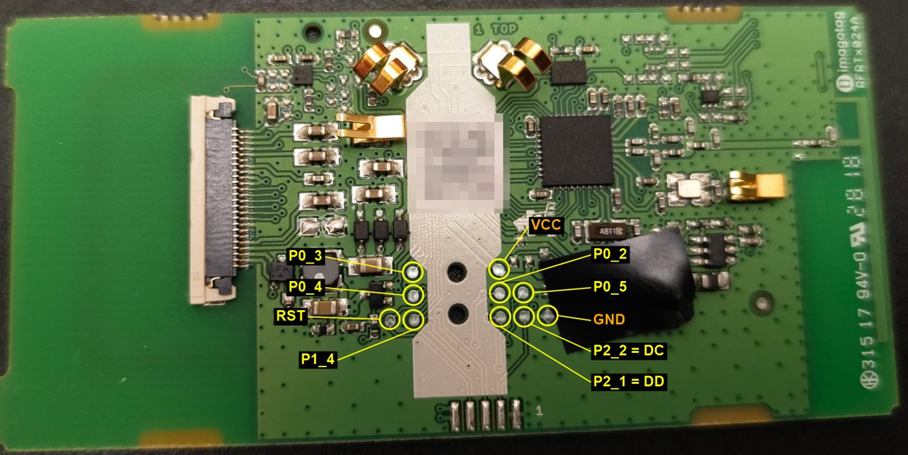
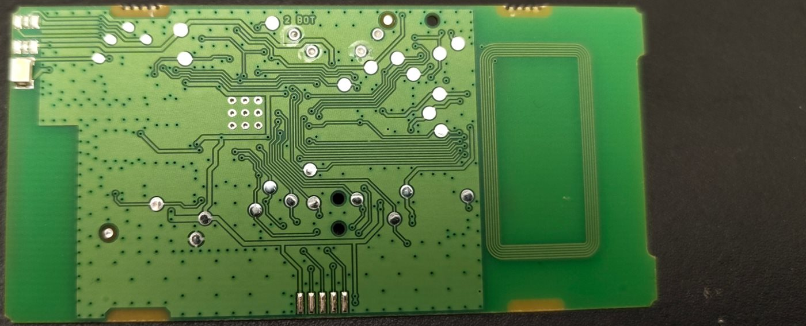

# vusion-cc2510-epaper

Custom firmware for **SES-imagotag VUSION 2.6 BWR** electronic shelf labels (board
*imagotag RFRTx024A*, **TI CC2510** microcontroller) plus tools to flash them with an **ESP32**:
text, lists and **images** over 2.4 GHz radio, SPI flash, NFC and LED.

*Versión en español: [README.md](README.md). Code comments are in Spanish.*

> ⚠️ Only use labels you own. Flashing custom firmware **permanently erases** the original
> one (the flash comes locked and cannot be dumped). This is all experimental.

## What works

- Flashing the CC2510 through its debug interface with an ESP32 (bit-bang), **about 6 s** per
  firmware, sending the binary over the serial port (`grabar.bat`).
- Custom radio link between labels (2433 MHz, 250 kbps MSK) with ACK and retries.
- A label without a screen acts as a UART ↔ radio **bridge** for the ESP32.
- The label with a screen shows **text**, a **10-line list** and 296 × 152 black/white/red
  **images** (`imagen.bat photo.png`), stored in its flash.
- The bridge reads texts you write **from your phone over NFC**, keeps the last 10 in its flash
  and sends them to the screen when they change.
- The white LED blinks 3 times when something is received.

## Identified hardware

Board **RFRTx024A** (VUSION 2.6 BWR, GL320). Everything verified on the real board.

| Top side | Bottom side |
|---|---|
|  |  |

| Part | Details |
|---|---|
| MCU + radio | **TI CC2510** (8051, 32 KB flash, 4 KB RAM, CC2500-like radio). Chip ID `0x8104` |
| Display | Pervasive Displays **SE2266FS093** (2.66", 296 × 152, black/white/red, SPI) |
| External flash | **Winbond W25X10** (1 Mbit = 128 KB), marked `1H820`, USON-8. JEDEC `EF 30 11` |
| NFC | **NXP NTAG I2C plus 1K** (NT3H2111), I²C address `0x55` |
| Crystals | 26 MHz (radio and clock) and 32.768 kHz on P2_3/P2_4 (marked `A812N`) |
| LED | White, with a TPS61071 boost converter |

### CC2510 pinout

| Function | Pin |
|---|---|
| Display: power (active low) | P0_0 |
| Display: CS / SDI / CLK | P0_1 / P0_3 / P0_5 |
| Display: DC / BUSY (low = busy) / RESET | P1_2 / P1_3 / P2_0 |
| Flash: CS / CLK / MOSI (DI) / MISO (DO) | P1_4 / P1_5 / P1_6 / P1_7 (USART1 SPI, Alt.2) |
| Flash: power and WP# | **P1_0 = 1** (also powers the NFC chip) |
| NFC: SDA / SCL | P0_4 / P0_6 |
| LED | **P2_2 = 1** (boost enable) **and P2_1 = 1** |
| Debug: DD / DC / RESET | P2_1 / P2_2 / RESET_N (shared with the LED) |
| Bridge UART (screenless board) | **P0_3 = TX** (USART0 Alt.1), **P0_5 = RX** (USART1 Alt.1) |

The display uses Pervasive Displays' "iTC small" sequence: `0x00=0x0E` (reset), `0xE5=0x19`
(25 °C), `0xE0=0x02`, black plane `0x10`, red plane `0x13`, then `0x04` / `0x12` / `0x02`
waiting for BUSY. Each plane is 296 lines × 19 bytes; in landscape the line order is reversed.

### Top-side test pads (measured)

Next to the silver QR-code sticker, on both sides of the two holes, there are 10 round pads.
Measured with a multimeter on this board (looking at the top side, display connector on the
left):


```
     left side               right side
        P0_3          (o)       VCC
        P0_4          (o)       P0_2   P0_5
  RST   P1_4                    P2_1   P2_2   GND
```

| Signal | Use |
|---|---|
| VCC / GND | Power (3.3 V) |
| RST | Reset (flashing) |
| P2_1 | Debug **DD** (and LED) |
| P2_2 | Debug **DC** (and LED boost) |
| P0_3 / P0_5 | Bridge UART TX / RX (and display SDI / CLK) |
| P0_4 | NFC SDA |
| P1_4 | Flash CS |
| P0_2 | Unknown use |

This group has everything needed to flash (VCC, GND, RST, DD and DC) plus the bridge UART: the
easiest place to solder wires or use pogo pins.

## Wiring to the ESP32 (DevKit V1)

The back of the board has test pads for debugging. Everything at **3.3 V**, no level shifters,
**battery removed**.

| ESP32 | Board |
|---|---|
| 3V3 / GND | `+` / `-` |
| GPIO25 | RST |
| GPIO26 | DC (P2_2) |
| GPIO27 (direct) **and** GPIO32 (through 1 kΩ) | DD (P2_1) |
| GPIO16 (RX2) | P0_3 of the **bridge** board |
| GPIO17 (TX2) | P0_5 of the **bridge** board |

- RST/DC/DD go to the board you want to flash (**never to two boards at once**).
- The UART only goes to the bridge, **never to the screen label**: there P0_5 is the display
  clock (an output) and would fight the ESP32 TX pin.
- On the board not connected to the flasher, add **10 kΩ from DC to GND**: with DC floating, a
  reset can leave the CC2510 halted in debug mode.

## Requirements

- **SDCC 4.x** in `C:\Program Files\SDCC` (`winget install SDCC.SDCC`), or pass `-Sdcc <folder>`.
- **Arduino IDE** or arduino-cli with the **esp32** core, to upload `herramienta/herramienta.ino`.
- Windows with PowerShell 5.1 (the scripts use .NET; nothing else to install).

## Quick start

1. Upload `herramienta/herramienta.ino` to the ESP32 (once) and close the serial monitor.
2. Connect RST/DC/DD to the screen label and flash it (`-Borrar` = chip erase, needed the first
   time because it comes locked):
   ```bat
   grabar.bat receptor -Borrar
   ```
3. Move RST/DC/DD to a screenless board (the bridge), connect its UART and flash it:
   ```bat
   grabar.bat puente -Borrar
   ```
4. Send an image:
   ```bat
   imagen.bat logo.png
   imagen.bat photo.png -Foto       :: photos: dithered greys, red only in red areas
   imagen.bat logo.png -SoloVista   :: only writes logo_vista.png as a preview
   ```
5. Or write a text with an NFC app on the bridge board: it shows up in the screen's list.

In PowerShell prefix the scripts with `.\`, e.g. `.\grabar.bat receptor`.

### Tool commands (serial monitor at 115200, "Newline")

| Command | What it does |
|---|---|
| `t TEXT` | Sends text to the label (`\|` splits lines, max 4 × 24) |
| `d N` | Target label |
| `ping` | Checks that the bridge answers |
| `info`, `borrar` (erase), `grabar` (flash), `verificar` (verify), `run` | On the board wired to RST/DC/DD |
| `progreso`, `xdata` | Reads the diagnostic bytes (XDATA 0xFD00–0xFDFF) |
| `r`, `x`, `m [s]`, `escuchar [s]` | Reset and read the bridge UART |
| `vel N` | Debug clock half period in µs (default 2) |

After uploading any sketch to the ESP32, send `run`: the ESP32 reset can leave the connected
board halted.

## Firmwares

| Folder | Purpose |
|---|---|
| `receptor/` | Screen label: text, NFC list, images in flash, LED |
| `puente/` | Screenless board: UART ↔ radio modem + NFC text memory in flash |
| `hola_mundo/` | First display test |
| `nfc/` | Read, write and unlock the NTAG I2C |
| `prueba_led/` | LED combination test (shown on screen) |
| `explora*/` | Diagnostics used to find the flash and NFC (pull tests, I²C/SPI sweeps) |
| `comun/` | Display (`epd.h`), radio (`radio.h`), flash (`flash.h`), NFC (`nfc.h`) |

### Radio protocol

Frame: `[len][dst][type][seq][data]`, dst `0x00` = bridge, `0xFF` = all. Types: `T` text, `L`
list line, `P` paint list, `E` prepare image, `I` image chunk (`[pos16][55 bytes]`), `M` paint
image, `A` ACK (`[seq][rssi]`). The receiver ACKs before painting (a refresh takes about 20 s)
and ignores repeated sequence numbers. Image data is XOR-scrambled with a fixed table because
data whitening is off and long runs of `00`/`FF` arrived corrupted.

## Lessons learned

- The CC2510 flash comes **locked**: it can only be fully erased. The DEBUG_LOCKED status bit
  stays set after erasing; check by executing `MOV A,#0x5A` instead.
- With the CCLib library (ported to the ESP32) the chip ID read `0x0000`; the own bit-bang in
  `herramienta.ino` works, even at 2 µs per half cycle. The cause was not found.
- If the ESP32 **releases** RST, the slow edge left half of the boots running at 13 MHz (UART at
  half speed). Drive RST high actively.
- Clock switch: wait until `CLKCON` reads `0x80` before powering down the RC (datasheet 12.1.5).
- The CC2510 has no ST0–ST2: read the sleep timer through `WORTIME0/1`.
- The NTAG I2C comes locked **on the NFC side**, but over I²C the lock bits and CC can be cleared
  (NT3H2111 datasheet, 8.3.6–8.3.8). When writing block 0, byte 0 is the I²C address: use `0xAA`.
- Powering everything from the ESP32 3V3 works, but display current peaks can reset it.

## Credits and references

- [fishpepper/CC2510Lib](https://github.com/fishpepper/CC2510Lib) and [wavesoft/CCLib](https://github.com/wavesoft/CCLib): flash write method (TI SWRA124)
- [atc1441/ESP_CC_Flasher](https://github.com/atc1441/ESP_CC_Flasher): ideas for the tool
- [angrymew/firmware-cc2510](https://github.com/angrymew/firmware-cc2510): pinout of the sister GL120 board
- [18nelli18/Monopink](https://github.com/18nelli18/Monopink)
- TI CC2510, NXP NT3H2111 and Winbond W25X10 datasheets

## License

GPL-3.0 (see `LICENSE`). The flash write routine derives from CCLib / CC2510Lib (GPLv3).
